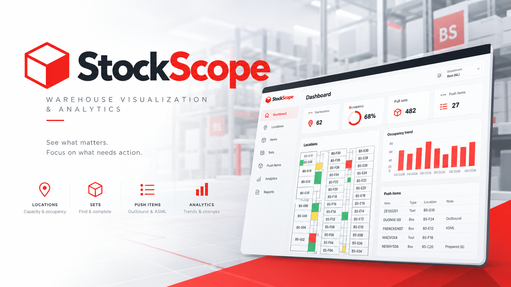

  

  <strong>Warehouse stock visualization and analysis application.</strong>

---

## About StockScope

I work with warehouse stock every day and often see the same problem:

the data already exists, but getting a simple and useful answer from it can take too much time.

The goal of StockScope is not to replace, duplicate or compete with the existing warehouse management system.

StockScope works as an additional layer on top of the warehouse data that already exists.

Its purpose is to make that data easier to see, understand and use, and to help turn it into useful operational information.

---

## Documentation

- [Project Architecture](./docs/architecture.md)
- [Development Notes](./docs/notes.md)
- [StockScope Study Guide (Slovak PDF)](./docs/StockScope_Study_Guide_SK.pdf)